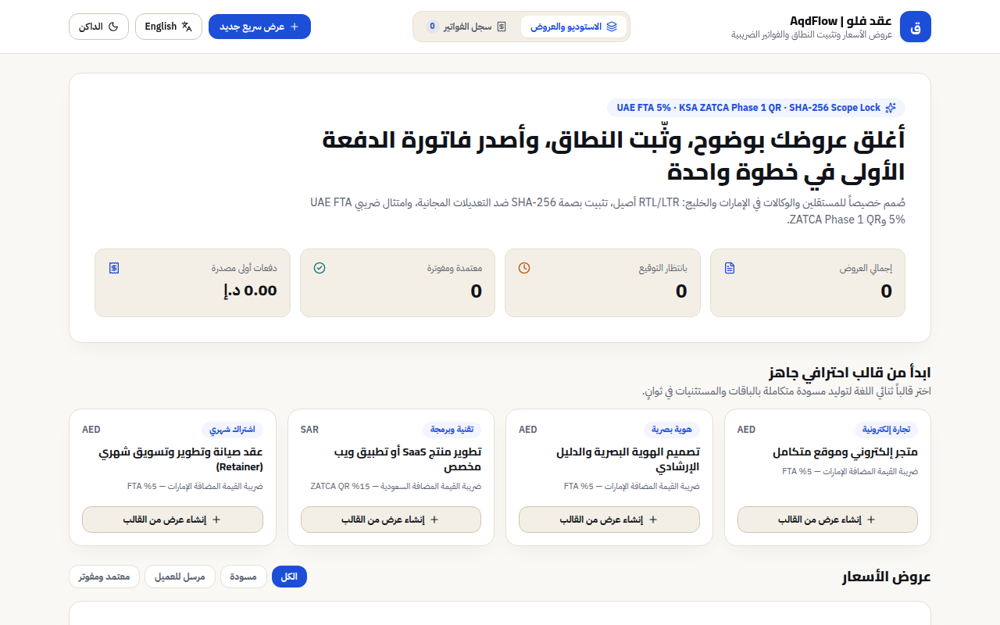
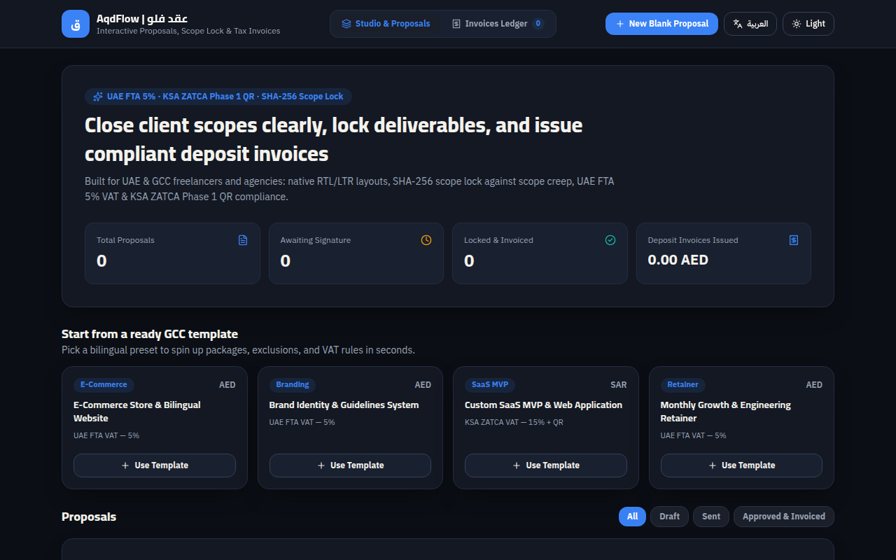
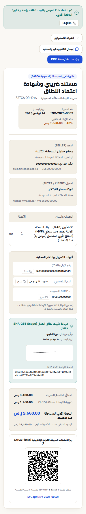

# عقد فلو | AqdFlow

[](https://github.com/manea/aqdflow/actions/workflows/ci.yml)
[](LICENSE)
**بوابة العروض التفاعلية وتثبيت نطاق العمل والتوقيع الإلكتروني وفواتير الدفعة الأولى (عربي RTL / إنجليزي LTR) للمستقلين والوكالات في الإمارات والخليج.**

AqdFlow is a lightweight, full-stack bilingual (`AR RTL / EN LTR`) proposal-to-deposit portal built with **React 19, Tailwind CSS v4, Node 22 (`node:sqlite` WAL)**, and dual-theme editorial aesthetics (**Warm Alabaster** light & **Obsidian Studio** dark).

---


## لقطات من الواجهة (UI Previews)

### لوحة الاستوديو — العربية RTL (`Warm Alabaster Light`)


### لوحة الاستوديو — الإنجليزية LTR (`Obsidian Studio Dark`)


### فاتورة ضريبية على الجوال `390x844` — توقيع مرسوم + `KSA ZATCA Phase 1 QR`


---
## المزايا الأساسية (Core Capabilities)

1. **محرر العروض السريع + 4 قوالب خليجية جاهزة**:
   - المتاجر الإلكترونية والمواقع (`AED` / `UAE FTA 5%`)
   - الهوية البصرية والدليل الإرشادي (`AED` / `UAE FTA 5%`)
   - تطوير منتج `SaaS MVP` (`SAR` / `KSA ZATCA 15% + QR`)
   - عقود الصيانة والنمو الشهري (`Retainer`)
2. **بوابة العميل العامة (`/p/:slug`)**:
   - اختيار الباقة والخدمات الإضافية مع تحديث لحظي للإجمالي والدفعة الأولى المستحقة.
   - فصل بصري واضح بين **ضمن نطاق العمل** و**المستثنيات الصريحة** لمنع توسع النطاق المجاني (`Scope Creep`).
   - التوقيع بالرسم (`Canvas` باللمس/الفأرة) أو بالكتابة، مع تأكيد وتثبيت بصمة النطاق `SHA-256`.
3. **إصدار فاتورة الدفعة الأولى ذرياً + القفل غير القابل للتعديل**:
   - بمجرد الاعتماد يوصَد العرض (`409 PROPOSAL_LOCKED` ضد أي تعديل لاحق) ويُمنح رقم فاتورة متسلسل ذري `INV-YYYY-0001`.
4. **مستند الفاتورة الضريبية القابل للطباعة PDF (`/invoice/:invoiceNumber`)**:
   - قواعد `@media print` بمقاس `A4` مع إخفاء أزرار التحكّم `.no-print`.
   - فحص امتثال **الإمارات FTA VAT 5%** (حد `10,000` د.إ للفاتورة المبسطة مقابل الكاملة + تحذيرات TRN).
   - توليد رمز **QR بصيغة `SVG`** (متوافق مع **KSA ZATCA Phase 1 TLV Base64** بالوسوم الخمسة القياسية بترميز UTF-8).

---

## مصفوفة الامتثال الضريبي (Compliance Matrix)

| النظام الضريبي | الحد / المعيار | التصنيف التلقائي | الحقول والتحقق |
| :--- | :--- | :--- | :--- |
| `none` (`0%`) | بدون ضريبة | `receipt` | إيصال دفعة / مستند مالي بدون ضريبة |
| `uae_fta_5` (`5%`) | إجمالي شامل الضريبة `<= 10,000 AED` | `uae_simplified_tax_invoice` | فحص TRN المورد (15 رقماً يبدأ بـ `100`) |
| `uae_fta_5` (`5%`) | إجمالي شامل الضريبة `> 10,000 AED` | `uae_full_tax_invoice` | ينبّه عند غياب TRN العميل/المورد أو العنوان |
| `ksa_zatca_15` (`15%`) | متوافقة مع المرحلة الأولى ZATCA | `ksa_simplified_tax_invoice` / `ksa_standard_tax_invoice` | يولّد رمز TLV Base64 (وسوم 1..5) + نقطة `/qr.svg` |

---

## التشغيل السريع محلياً (Quickstart)

```bash
cd projects/aqdflow
npm install
npm run typecheck
npm test
npm run build
npm start
# يفتح الخادم على http://127.0.0.1:4179
```

### أوامر التطوير والاختبار (Scripts)
- `npm run dev` — تشغيل `Vite` محلياً للتطوير.
- `npm run typecheck` — فحص TypeScript (`tsc --noEmit`).
- `npm test` — تشغيل اختبارات `Vitest` للوحدة وتكامل الخادم (`aqdflowCore.test.ts`, `aqdflowServer.test.ts`).
- `npm run build` — بناء حزمة الإنتاج داخل `dist/`.
- `npm run test:e2e` — اختبارات `Playwright` الشاملة على سطح المكتب والجوال `390x844`.
- `npm run start:lan` — تشغيل خادم الإنتاج على `0.0.0.0:4179`.

---

## ملخص واجهات API (`server/app.mjs`)

- `GET /api/health` — فحص حالة الخدمة والإصدار وإحصاءات قاعدة البيانات.
- `GET /api/templates` — استعراض القوالب الأربعة الجاهزة.
- `GET /api/proposals` / `POST /api/proposals` — قائمة العروض وإنشاء مسودة من قالب.
- `GET|PATCH|DELETE /api/proposals/:id` — قراءة/تعديل/حذف المسودات والعروض غير المقفلة.
- `POST /api/proposals/:id/publish` — نشر العرض وإتاحة رابط العميل `/p/:slug`.
- `POST /api/proposals/:id/duplicate` — استنساخ عرض مقفل/منشور إلى مسودة جديدة قابلة للتعديل.
- `GET /api/public/proposals/:slug` — عرض بوابة العميل العامة (مع احتساب المشاهدات).
- `POST /api/public/proposals/:slug/approve` — اعتماد النطاق + التوقيع + القفل وإصدار فاتورة الدفعة الأولى.
- `GET /api/invoices` / `GET /api/invoices/:invoiceNumber` — سجل الفواتير الصادرة.
- `GET /api/public/invoices/:invoiceNumber/qr.svg` — رمز `SVG QR` مباشر لترميز ZATCA TLV.

---

## النشر ($0) والمشاركة
راجع دليل النشر والمشاركة التفصيلي في [`launch/DEPLOY-AND-SHARE.md`](launch/DEPLOY-AND-SHARE.md) وتهيئة [`wrangler.jsonc`](wrangler.jsonc) و[`Dockerfile`](Dockerfile) و[`docker-compose.yml`](docker-compose.yml) ومجلد [`deploy/`](deploy/).
